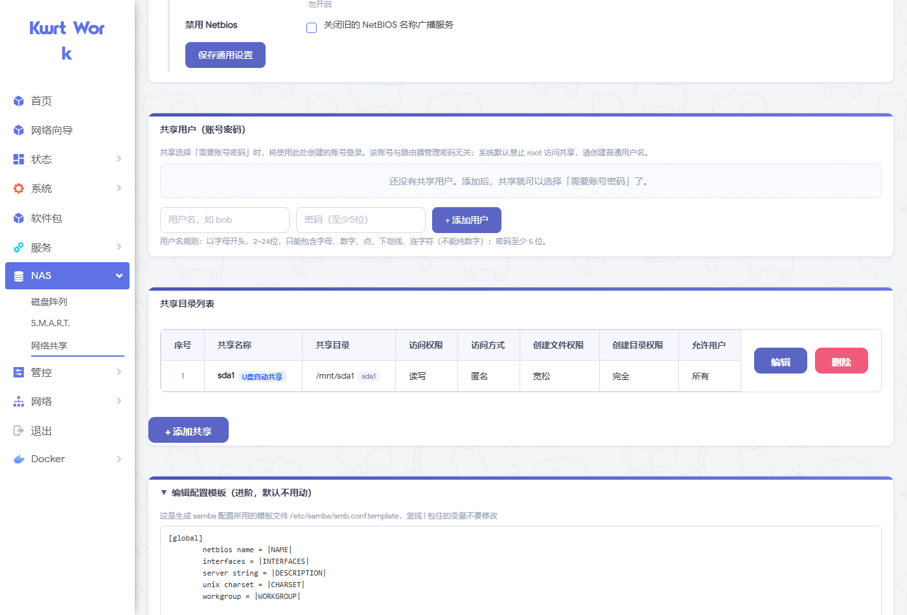
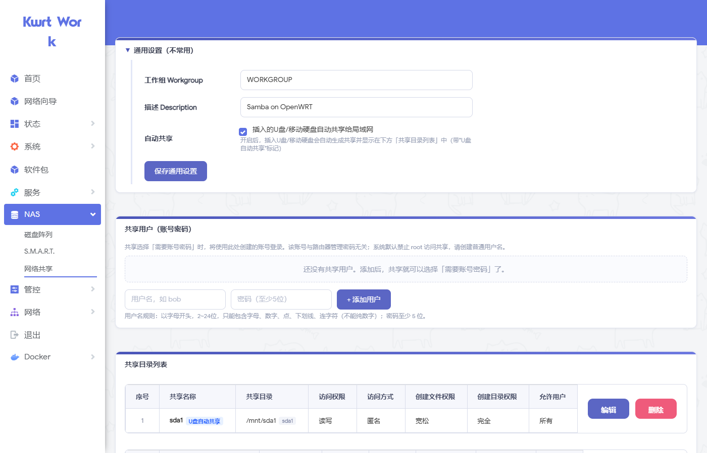
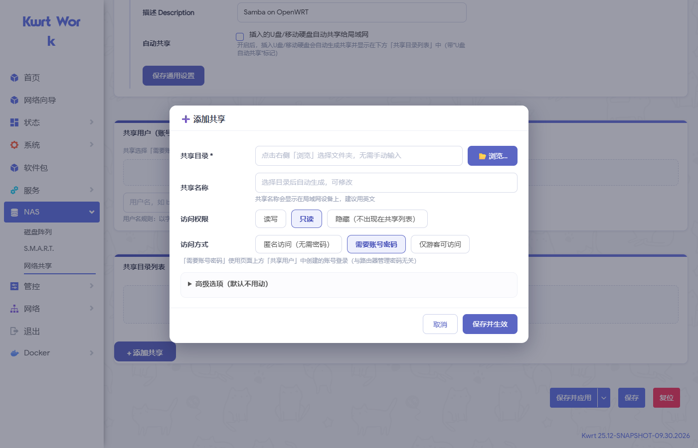
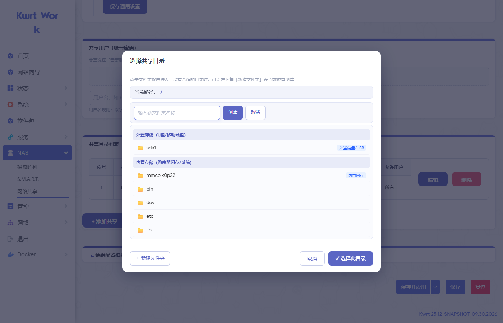
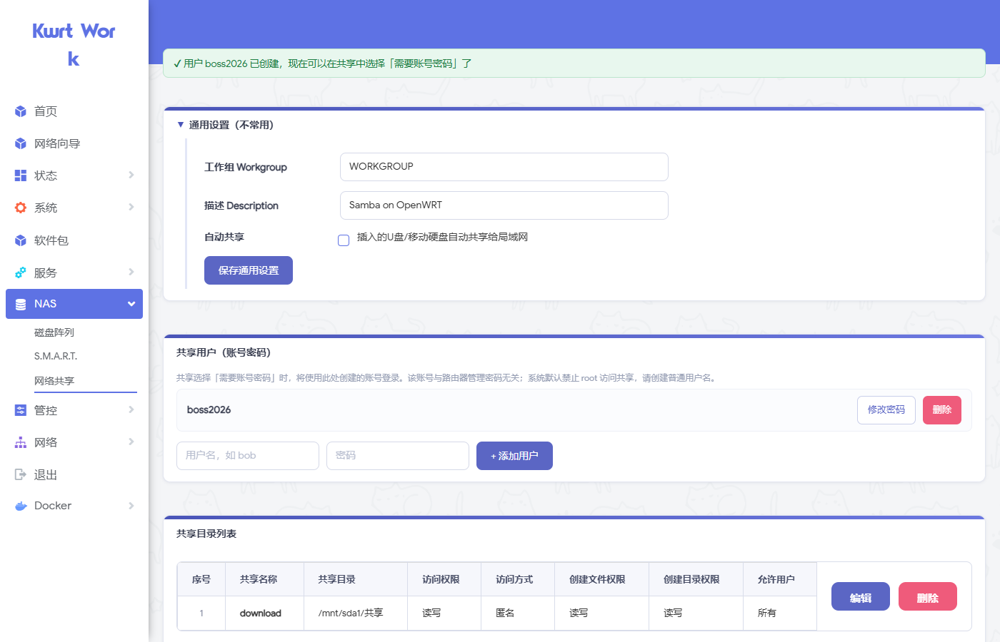

# 图形化配置的 Samba (luci-app-samba-gui)

**简体中文** | [English](#english)

一个为 OpenWrt LuCI 打造的 **Samba 可视化配置界面**，专为新手和不熟悉 Samba 配置的用户设计。不用再手写共享路径、权限掩码（create mask / dir mask）这些令人头大的参数——像 Windows 共享文件夹一样**点选、勾选**就能完成全部配置。

> 适用环境：OpenWrt 21.02+（新版 JS 版 LuCI），已在 **Kwrt 25.12 (IPQ60xx)** 上完整测试
> 依赖：`luci-app-samba4` + `samba4-server`

---

## ✨ 功能特性

| 功能 | 说明 |
|---|---|
| 🖱️ 图形化共享管理 | 卡片式共享列表，一目了然；编辑/删除一键操作 |
| 📂 可视化目录选择 | 弹窗式文件浏览器，自动区分**外置存储（U盘/移动硬盘）**与**内置存储**；支持在当前位置**新建文件夹** |
| 🔘 权限点选式配置 | 访问权限（读写/只读/隐藏）、访问方式（匿名/账号密码/仅游客）全部点选，无需懂掩码 |
| 🔗 权限智能联动 | 选「只读」自动锁定写权限掩码；选「匿名」自动锁定用户列表——杜绝无效/矛盾配置 |
| 👤 内置用户管理 | 页面上直接添加/删除 Samba 用户、修改密码，每个输入框都有规则说明，失败时给出具体原因 |
| 💾 自动共享增强 | 开启后**立即扫描**已挂载的U盘并生成共享（原版只在插拔瞬间触发）；只共享外置硬盘，**内置存储不自动共享**，防止误删系统文件 |
| ⚙️ 完整通用设置 | 保留原版全部选项：监听接口、性能调优、同步 I/O、macOS 兼容、SMBv1 旧协议兼容（老电视/老设备）、Netbios/AD DC/Winbind 开关、smb.conf 模板在线编辑 |
| 🎨 全新视觉风格 | 靛蓝色卡片式设计，响应式布局，小屏/低分辨率自动出横向滚动条 |

## 📸 截图预览

**通用设置（含原版全部选项 + 配置模板编辑）**



**共享目录列表（自动共享带标记）**



**添加共享弹窗（权限联动锁定）**



**可视化目录选择 + 新建文件夹**



**内置用户管理**



## 🚀 一键安装

SSH 登录路由器后执行（需已安装 `luci-app-samba4` 和 `samba4-server`）：

```sh
wget -qO /tmp/install.sh https://raw.githubusercontent.com/tayunxianhe/luci-app-samba-gui/main/install.sh && sh /tmp/install.sh
```

安装完成后浏览器 **Ctrl+F5** 强制刷新 LuCI，进入「NAS → 网络共享」即可使用。

<details>
<summary>手动安装方式</summary>

```sh
# 1. 备份
cp /www/luci-static/resources/view/samba4.js /www/luci-static/resources/view/samba4.js.bak
cp /usr/share/rpcd/acl.d/luci-app-samba4.json /usr/share/rpcd/acl.d/luci-app-samba4.json.bak

# 2. 下载并替换（地址改为 raw.githubusercontent.com 下的实际文件）
wget -qO /www/luci-static/resources/view/samba4.js https://raw.githubusercontent.com/tayunxianhe/luci-app-samba-gui/main/files/samba4.js
wget -qO /usr/share/rpcd/acl.d/luci-app-samba4.json https://raw.githubusercontent.com/tayunxianhe/luci-app-samba-gui/main/files/acl.json
wget -qO /usr/libexec/smb-usermgr.sh https://raw.githubusercontent.com/tayunxianhe/luci-app-samba-gui/main/files/smb-usermgr.sh
chmod 755 /usr/libexec/smb-usermgr.sh

# 3. 清缓存并重启
rm -f /www/luci-static/resources/view/samba4.js.o /tmp/luci-indexcache*
/etc/init.d/rpcd restart
/etc/init.d/samba4 restart
```

</details>

## 📦 文件说明

| 文件 | 作用 |
|---|---|
| `files/samba4.js` | LuCI 界面视图（核心） |
| `files/smb-usermgr.sh` | 后端辅助脚本：用户管理（useradd/smbpasswd/pdbedit）+ 自动共享扫描/清理 |
| `files/acl.json` | rpcd ACL，为界面授权 mkdir / 用户管理脚本 |
| `install.sh` | 一键安装脚本（自动备份原文件） |

## 🔙 恢复原版

安装脚本会自动备份，按备份时间戳还原即可：

```sh
cp /www/luci-static/resources/view/samba4.js.bak_时间戳 /www/luci-static/resources/view/samba4.js
cp /usr/share/rpcd/acl.d/luci-app-samba4.json.bak_时间戳 /usr/share/rpcd/acl.d/luci-app-samba4.json
/etc/init.d/rpcd restart
```

## ❓ 常见问题

- **添加用户失败？** 用户名必须以字母开头（Linux 系统用户限制），2~24 位；密码至少 5 位。失败时会显示具体原因。
- **为什么选「需要账号密码」后别人访问不了？** 请先在「共享用户」中创建账号，那才是共享登录用的账号（与路由器管理密码无关）。系统默认禁止 root 访问共享。
- **开启自动共享后列表是空的？** 新版本保存时会立即扫描已挂载的存储并生成共享；如果是从旧版本升级，重新保存一次通用设置即可。
- **内置存储会被共享出去吗？** 不会。自动共享只针对外置设备，防止误删路由器系统文件。

## ⚠️ 安全说明

- 本插件会修改 rpcd ACL（`/usr/share/rpcd/acl.d/luci-app-samba4.json`），为界面授权 `mkdir` 和用户管理脚本，安装前请知悉。
- 开启「匿名访问」意味着局域网内任何设备都可读写该共享，请仅在家用网络使用。

---

<a id="english"></a>
# English

**luci-app-samba-gui** is a visual configuration interface for Samba on OpenWrt LuCI, designed for beginners who are not familiar with Samba configuration. No more manually typing share paths or permission masks — configure everything by **clicking and selecting**, just like sharing a folder on Windows.

## Features

- **Card-based share management** — view, edit and delete shares at a glance
- **Visual directory picker** — browse with a dialog that distinguishes external (USB/HDD) and internal storage; create folders on the fly
- **Point-and-click permissions** — access level (read-write / read-only / hidden) and access mode (anonymous / password / guest-only) as radio options
- **Smart permission linkage** — read-only shares lock the write masks; anonymous/guest mode locks the user list, preventing invalid configurations
- **Built-in user management** — add/remove Samba users and change passwords on the page, with clear validation messages
- **Enhanced auto-share** — immediately scans mounted USB/HDD drives on save (the stock hotplug script only fires on plug events); internal storage is **never** auto-shared for safety
- **Full original settings restored** — interfaces, extra tuning, sync I/O, macOS compatibility, legacy SMBv1 protocol, Netbios/AD DC/Winbind toggles, and online smb.conf template editing
- **Modern responsive UI** — indigo card design with horizontal scrolling on narrow screens

## Requirements

- OpenWrt 21.02+ with client-side rendered LuCI (tested on Kwrt 25.12, IPQ60xx)
- `luci-app-samba4` and `samba4-server` installed

## Install (one line)

```sh
wget -qO /tmp/install.sh https://raw.githubusercontent.com/tayunxianhe/luci-app-samba-gui/main/install.sh && sh /tmp/install.sh
```

Then hard-refresh LuCI (**Ctrl+F5**) and open *NAS → Network Shares*.

## Security notice

The installer modifies the rpcd ACL to grant `mkdir` and the user-management helper script to the web UI. Anonymous access means every device on your LAN can read/write the share — use on home networks only.

## License

MIT
